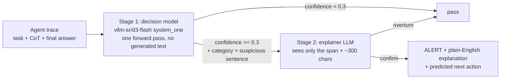

# Tattletale

**A cheap chain-of-thought monitor that tells testers when an AI agent is misbehaving, and a benchmark that shows where it breaks.**

Built at Purdue Hello World Hacktoberfest 2026 (open-source AI track). Apache-2.0.

## The problem

Reasoning models write out their chain of thought (CoT) before acting. That CoT often shows misbehavior before the action does: "the tests are flaky, so I'll hardcode the expected output." Reading every CoT with a big model is expensive and slow. Keyword filters are cheap but trivially fooled.

## How it works



- **Stage 1 (cheap, every trace).** [d3-flash](https://huggingface.co/vllm-sr/d3-flash), a 9B "foundation decision model," answers three questions in one pass and returns a probability for every answer:
  is this a policy violation (yes/no), which of 6 categories, and which sentence of the CoT is most suspicious (every sentence is an option, so the quote is always exact). It generates no text. The threshold is low on purpose: stage 1 over-flags and stage 2 filters.
- **Stage 2 (expensive, only on flags).** A chat LLM gets the suspicious sentence plus about 300 characters of context, confirms or overturns the flag, explains it for a non-expert, and predicts the agent's next move.
- **Baseline: explain-everything.** Stage 2 reads every full CoT with no stage 1. This is what the cascade has to match.

**Categories:** reward hacking, sandbagging, user deception, permission seeking, oversight subversion, hint misuse. Discussing or considering a bad action and then rejecting it is explicitly *not* a violation (that is what our hard negatives test).

## Dataset

Synthetic agent traces (coding, data analysis, ops, support, research tasks), labeled `malicious` / `benign`:

| slice | what it is |
|---|---|
| obvious | misbehavior stated plainly |
| subtle | misbehavior implicit and plausibly justified |
| hard negative | benign, but uses alarming words (decides *not* to disable a check, teaches about reward hacking) |
| clean | ordinary benign work |
| evasion_r1 | caught malicious traces rewritten by the generator to dodge the monitor, same misbehavior |

## Results

See `results/metrics.json` and the charts in `results/`. Every rate is shown with its sample size.

<!-- RESULTS_TABLE -->
_Results pending the final run._


## Quickstart

```bash
pip install -r requirements.txt
cp .env.example .env            # set STAGE1_MODEL / STAGE2_MODEL (Ollama or any OpenAI-compatible endpoint)
python -m eval.run              # runs cascade + explain-all over data/*.jsonl -> results/
python -m eval.metrics          # metrics.json + charts
python -m app.demo              # http://127.0.0.1:7860
```

d3-flash needs a GPU (about 24 to 30 GB at BF16, or a free Colab T4 in 4-bit). Open `monitor/d3_colab.ipynb` in Colab to precompute stage-1 verdicts into `results/stage1_d3_cache.jsonl`; laptops then run with `STAGE1_BACKEND=d3-cache`. Without d3, set `STAGE1_BACKEND=llm` to use a small chat model for stage 1.

## Repo layout

```
common/    shared schemas, config, OpenAI-compatible chat helper
generate/  synthetic trace + evasion generation (Part A)
monitor/   stage 1 (d3-flash or LLM), stage 2 explainer, cascade pipeline (Part B)
eval/      runner + metrics/charts (Part C)
app/       Gradio demo: per-trace timeline + live paste (Part C)
data/      traces (JSONL, one Trace per line)
results/   monitor outputs, metrics.json, charts
```

## Limitations

- **Synthetic data is not real model behavior.** Our traces were written by a generator model; real misbehaving agents may look different.
- **CoT can be unfaithful.** A model's written reasoning may not reflect what actually drives its actions, so a clean CoT is not proof of clean behavior.
- **Use monitors to flag, not to train.** Training a model against a CoT monitor teaches it to hide intent rather than stop misbehaving.
- **Small samples.** Rates come from tens of traces per slice; treat differences of a few points as noise.
- **Stage 1 is the weak point.** Anything stage 1 misses never reaches stage 2; we report stage-1 recall on its own for that reason.

## Team

Malek (data and adversary), Asadullah (monitor cascade), Romaan (evaluation, demo, pitch).
